<div align="center">

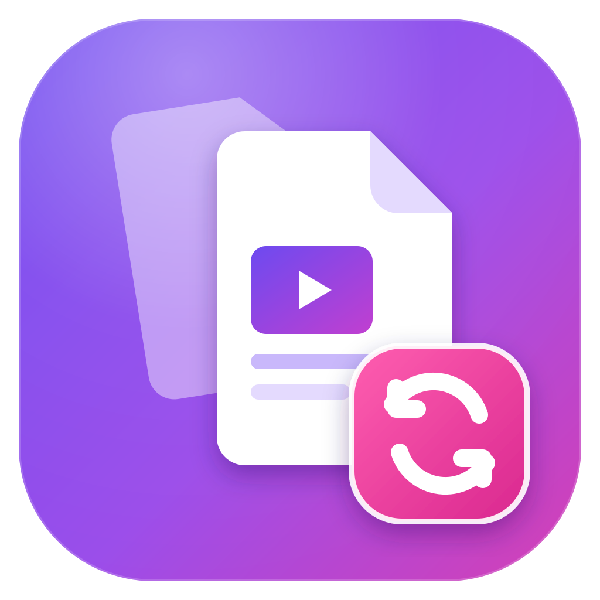

# GCP Converter

**Conversor universal de vídeo, áudio, imagens, documentos e e-books, com compactação inteligente e conversão em lote.**

Livre · Gratuito · Offline · Linux, Windows e macOS

[](https://github.com/cliqueprojeto/GCP-Converter/releases/latest)
[](https://github.com/cliqueprojeto/GCP-Converter/releases)
[](LICENSE)


**[⬇️ Baixar](#-download-e-instalação)** · **[✨ Recursos](#-recursos)** · **[🖼️ Telas](#️-telas)** · **[📜 Versões](CHANGELOG.md)** · **[❤️ Apoie](#️-apoie-o-projeto)**

🇧🇷 Português · [🇺🇸 English](#-english) · [🇪🇸 Español](#-español)

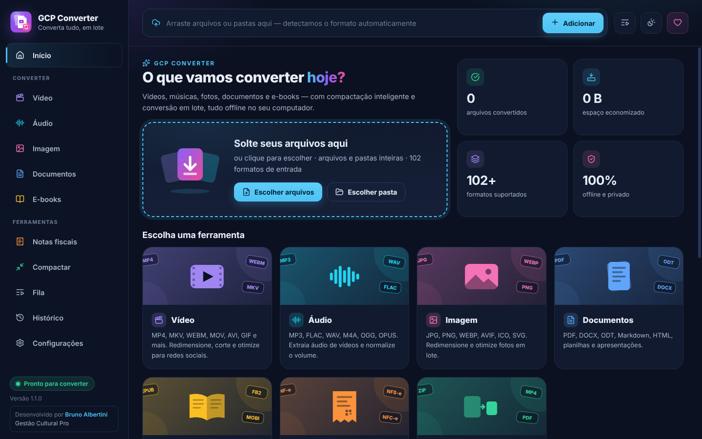

</div>

---

## Sobre

O **GCP Converter** faz parte da série de aplicativos **GCP** da [Gestão Cultural Pro](https://www.gestaoculturalpro.com.br). Ele reúne em um só lugar o que normalmente exige vários programas: converter vídeos, músicas, fotos, documentos e livros digitais, reduzir o tamanho de arquivos e processar centenas de itens de uma vez.

Tudo acontece **no seu computador**. Nenhum arquivo é enviado para a internet.

## ✨ Recursos

| | Ferramenta | Formatos de saída | Destaques |
|---|---|---|---|
| 🎬 | **Vídeo** | MP4, MKV, WEBM, MOV, AVI, WMV, M4V, FLV, MPEG, 3GP, GIF, WEBP animado | H.264, H.265/HEVC, VP9 e AV1 · resolução, FPS e qualidade · cortar trecho · girar e espelhar · velocidade · aceleração por GPU (NVIDIA, Intel, AMD, Apple) |
| 🎵 | **Áudio** | MP3, M4A/AAC, OGG, OPUS, FLAC, WAV, AIFF, ALAC, WMA, AC3, AMR | Extrai áudio de vídeos · normalização de volume (EBU R128) · fade in/out · remover silêncios · mantém a capa do álbum |
| 🖼️ | **Imagem** | JPG, PNG, WEBP, AVIF, GIF, BMP, TIFF, ICO, PDF | Aceita SVG · **PDF → imagens (uma por página)** · redimensionar · qualidade · girar · preto e branco · reduzir paleta do PNG · remover metadados |
| 📄 | **Documentos** | PDF, DOCX, ODT, RTF, TXT, HTML, Markdown, XLSX, ODS, CSV, PPTX, ODP, EPUB | **Motor do GCP-PDF embutido**: Word e Excel com layout fiel · PDF → Word, PowerPoint e Excel editáveis · XML de NF-e → DANFE · unir vários arquivos em um único PDF |
| 📚 | **E-books** | EPUB, MOBI (Kindle), FB2, PDF, DOCX, ODT, RTF, TXT, HTML, Markdown | Lê MOBI, AZW, AZW3, FB2, CBZ, CBR e CB7 · gera EPUB 3 com sumário e MOBI para Kindle **sem Calibre** · título, autor e capa nos metadados |
| 🧾 | **Notas fiscais** | PDF no leiaute oficial | XML → **DANFE** (NF-e), **DANFE NFC-e** (bobina 80 mm), **DANFSe v2.0** (NFS-e nacional), NFS-e ABRASF, **extrato do CF-e SAT** e CT-e · QR Code, código de barras e chave de acesso · em lote, com opção de unir tudo em um PDF |
| 🗜️ | **Compactar** | Mesmo formato ou ZIP | 4 níveis: leve, recomendado, máximo e **tamanho exato em MB** · vídeos, áudios, imagens e PDFs · ZIP de vários arquivos |

### Conversão em lote

- Arraste **arquivos ou pastas inteiras** para qualquer lugar da janela: o GCP Converter identifica o tipo e envia cada arquivo para a ferramenta certa.
- **Fila** com progresso em tempo real, velocidade de conversão, cancelar, tentar de novo e quanto espaço foi economizado.
- **Conversões simultâneas** configuráveis (1 a 8).
- **Destino**: mesma pasta do original ou uma pasta escolhida.
- **Nome dos arquivos**: o nome original é preservado e ganha `_Convertido`, `_Compactado` ou `_Unido` no final (no idioma do app: `_Converted`/`_Compressed` em inglês, `_Convertido`/`_Comprimido` em espanhol). Exemplo: `Relatório.docx` → `Relatório_Convertido.pdf`. Também dá para personalizar com `{name}`, `{action}`, `{target}`, `{ext}`, `{date}`, `{time}` e `{index}`.
- O arquivo original **nunca é sobrescrito**.

### Predefinições prontas

| Vídeo | Áudio | Imagem |
|---|---|---|
| YouTube 1080p · Instagram Reels · TikTok/Shorts · WhatsApp · E-mail leve · 4K (H.265) · Web (WEBM) | Podcast · Música 320k · Audiófilo (FLAC) · WhatsApp · Toque 30s · Estúdio 48k | Web (WEBP) · Redes sociais · Miniatura · Impressão (TIFF) · Ícone · Ultra leve (AVIF) |

### Interface

- Visual premium, coeso com a série GCP.
- **Temas escuro, claro ou do sistema**, e ícone em duas variantes (gradiente ou claro).
- **Português, inglês e espanhol**, com detecção automática do idioma do sistema (pode ser trocado nas Configurações).
- Ícones e ilustrações contextuais em cada ferramenta, formato e predefinição.
- Histórico de conversões e estatísticas.

### Atualizações automáticas

Novas versões chegam direto das [Releases do GitHub](https://github.com/cliqueprojeto/GCP-Converter/releases). Em **Configurações → Geral → Atualizações** você escolhe quando verificar:

> Sempre que abrir o programa · Todos os dias · A cada semana · A cada duas semanas · A cada mês · Nunca

Também dá para **verificar agora** e abrir a **página de versões**. Quando há novidade, o aplicativo mostra as notas da versão e instala o pacote certo para o seu sistema: `.exe`, `.dmg`, `.deb`, `.rpm`, `.pkg.tar.zst` ou AppImage.

## ⬇️ Download e instalação

Baixe o arquivo do seu sistema na [página da última versão](https://github.com/cliqueprojeto/GCP-Converter/releases/latest).

| Sistema | Arquivo | Como instalar |
|---|---|---|
| **Windows 10/11** | `GCP-Converter-Setup-x.y.z-x64.exe` | Dê dois cliques. O aplicativo instala e abre sozinho. |
| **macOS Apple Silicon (M1, M2, M3, M4…)** | `GCP-Converter-x.y.z-arm64.dmg` | Abra o `.dmg` e arraste o GCP Converter para **Aplicativos**. |
| **macOS Intel** | `GCP-Converter-x.y.z-x64.dmg` | Abra o `.dmg` e arraste o GCP Converter para **Aplicativos**. |
| **Debian, Ubuntu, Mint, Pop!_OS** | `GCP-Converter-x.y.z-amd64.deb` | Dê dois cliques e escolha **Instalar**. |
| **Fedora, openSUSE, RHEL** | `GCP-Converter-x.y.z-x86_64.rpm` | Dê dois cliques e escolha **Instalar**. |
| **Arch, BigLinux, Manjaro** | `GCP-Converter-x.y.z-x86_64.pkg.tar.zst` | Dê dois cliques (abre no gerenciador de pacotes) e confirme. |
| **Qualquer Linux** | `GCP-Converter-x.y.z-x86_64.AppImage` | Torne executável e dê dois cliques. |

<details>
<summary><b>Instalar pelo terminal (Linux)</b></summary>

```bash
# Debian / Ubuntu / Mint
sudo apt install ./GCP-Converter-*-amd64.deb

# Fedora
sudo dnf install ./GCP-Converter-*-x86_64.rpm

# Arch / BigLinux / Manjaro
sudo pacman -U GCP-Converter-*-x86_64.pkg.tar.zst

# AppImage
chmod +x GCP-Converter-*-x86_64.AppImage && ./GCP-Converter-*-x86_64.AppImage
```
</details>

<details>
<summary><b>Avisos de segurança no primeiro uso (Windows e macOS)</b></summary>

O GCP Converter ainda não usa certificados pagos de assinatura de código, por isso o sistema pode exibir um aviso na primeira vez:

- **Windows (SmartScreen):** clique em **Mais informações → Executar assim mesmo**.
- **macOS:** clique com o botão direito no app em Aplicativos → **Abrir** → **Abrir**. Se aparecer "está danificado", rode no Terminal:
  ```bash
  xattr -cr "/Applications/GCP Converter.app"
  ```
</details>

### Motores de conversão — tudo embutido

**Nada precisa ser instalado.** O GCP Converter já traz:

| Motor | O que faz |
|---|---|
| **FFmpeg** | Vídeo, áudio e imagens |
| **Motor de documentos do [GCP-PDF](https://github.com/cliqueprojeto/GCP-PDF)** | Word e Excel → PDF com layout de página fiel; PDF → Word, PowerPoint, Excel, EPUB e imagens com layout preservado; EPUB, quadrinhos e XML fiscal |
| **Leitores e geradores próprios** | ODT, ODS, ODP, PPTX e RTF (títulos, listas, tabelas, imagens, cores, mesclagens, moeda, porcentagem, datas e layouts de slide) |
| **Motor de e-books** | Lê MOBI, AZW, AZW3, FB2, CBZ, CBR e CB7; gera EPUB, MOBI (Kindle) e FB2 |

A conversão de documentos segue exatamente a ordem do GCP-PDF: **Microsoft Office** (Windows, se instalado) → **LibreOffice** (se instalado) → **motor interno**. Ou seja, quem já tem esses programas continua usando-os, e quem não tem converte normalmente.

Programas **opcionais**, detectados automaticamente em **Configurações → Motores**:

| Programa | Quando é útil |
|---|---|
| LibreOffice ou Microsoft Office | Formatos antigos do Office (`.doc`, `.xls`, `.ppt`) e máxima fidelidade em documentos do Office |
| Calibre | Gerar AZW3 e ler formatos raros de e-book (KFX, LIT, LRF, PDB, DjVu) |
| Ghostscript | Compactação mais forte de PDF |

## 🖼️ Telas

| Vídeo com predefinições | Áudio |
|---|---|
| 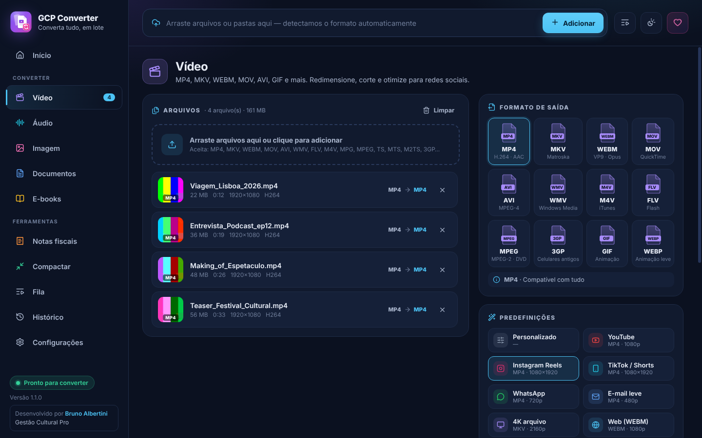 | 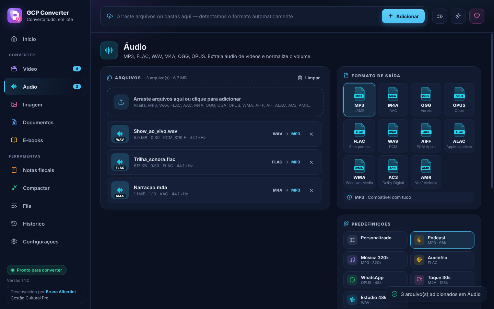 |
| **Imagem** | **Documentos** |
| 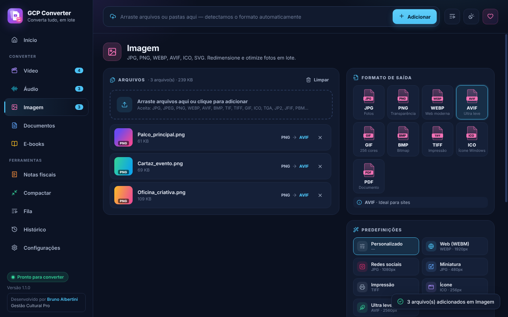 | 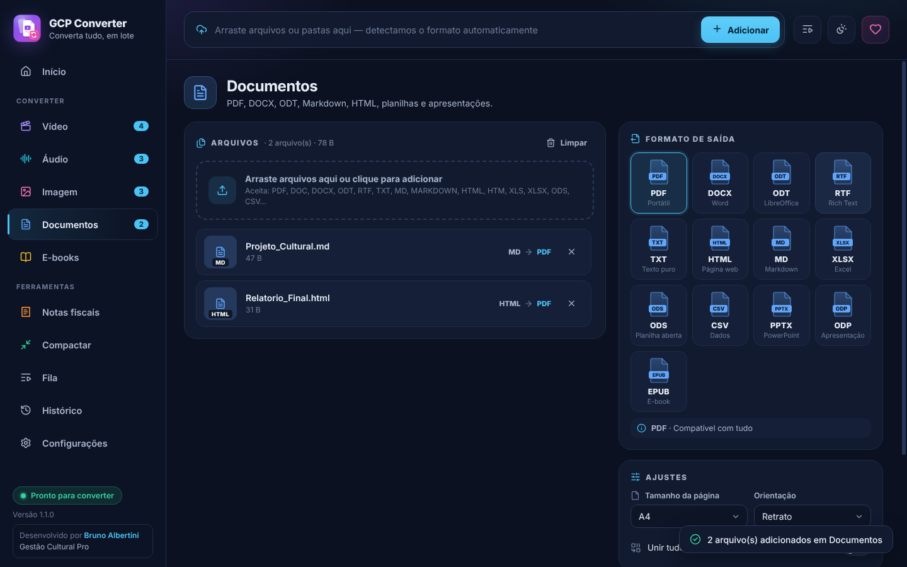 |
| **E-books** | **Compactar** |
| 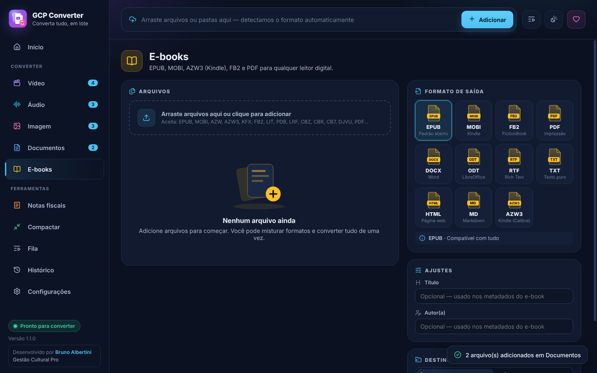 | 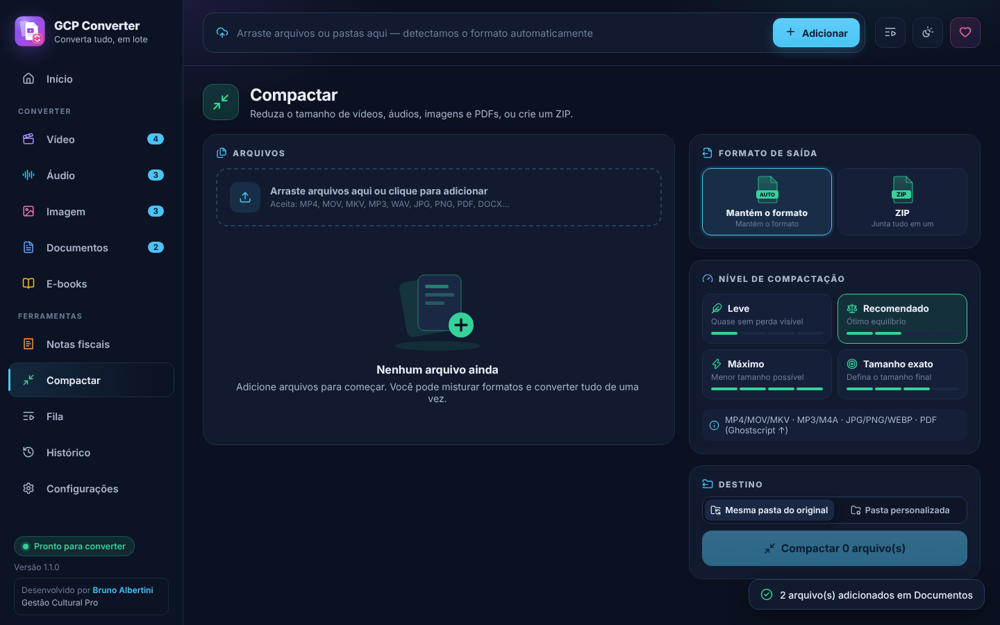 |
| **Fila de conversão em lote** | **Configurações e atualizações** |
| 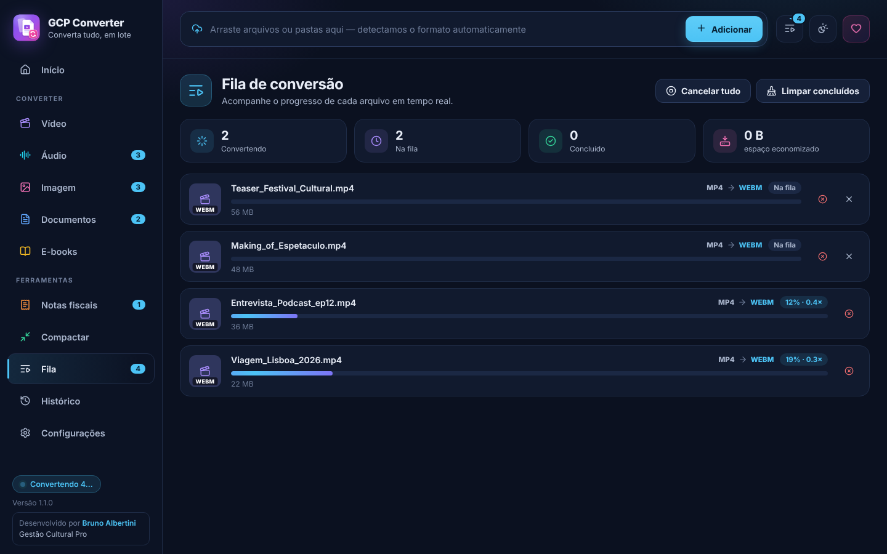 | 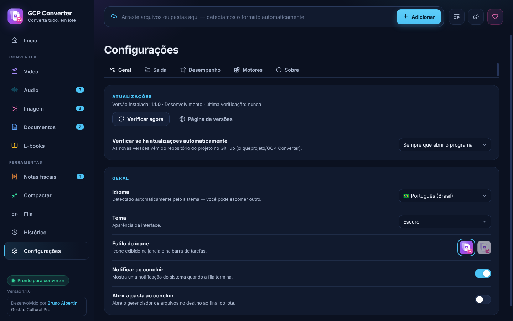 |
| **Motores de conversão** | **Sobre, histórico de versões e licenças** |
| 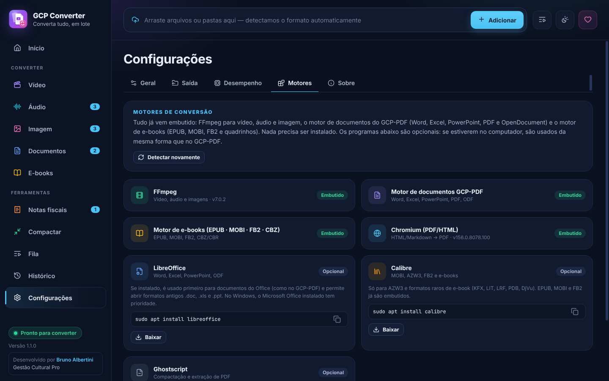 | 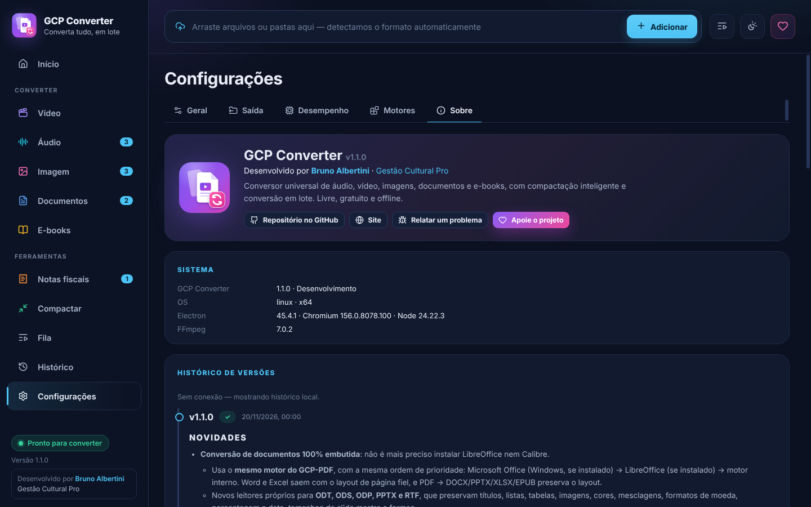 |
| **Notas fiscais (XML → DANFE/DANFSe)** | **Documentos** |
| 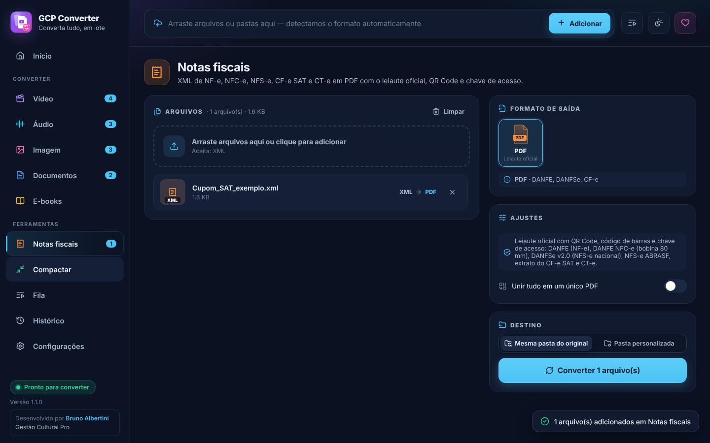 |  |
| **Apoie o projeto** | **Tema claro (inglês)** |
|  | 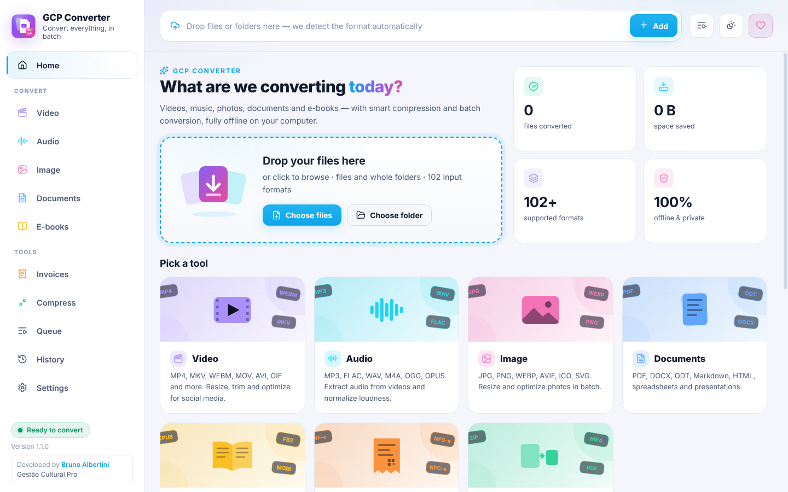 |

## 📜 Histórico de versões

As notas completas de cada versão estão no [CHANGELOG.md](CHANGELOG.md) e na [página de Releases](https://github.com/cliqueprojeto/GCP-Converter/releases). O próprio aplicativo mostra esse histórico em **Configurações → Sobre**.

## 🛠️ Desenvolvimento

Requisitos: Node.js 20+ e npm.

```bash
git clone https://github.com/cliqueprojeto/GCP-Converter.git
cd GCP-Converter
npm install
npm start
```

| Comando | O que faz |
|---|---|
| `npm start` | Abre o aplicativo |
| `npm run dev` | Abre com as ferramentas de desenvolvedor |
| `npm test` | Teste ponta a ponta de vídeo, áudio, imagem e compactação (Linux: `xvfb-run -a npm test`) |
| `npm run test:docs` | Teste ponta a ponta de documentos e e-books, inclusive sem LibreOffice (`GCP_NO_EXTERNAL=1`) |
| `npm run vendor:gcp-pdf` | Atualiza o motor de documentos a partir do repositório do GCP-PDF |
| `npm run dist:linux` | Gera `.deb`, `.rpm`, `.pkg.tar.zst` e AppImage |
| `npm run dist:win` | Gera o instalador do Windows |
| `npm run dist:mac` | Gera o `.dmg` do macOS |
| `npm run icons` | Recria o pacote de ícones da interface |

### Publicar uma nova versão

1. Atualize `version` no `package.json` e adicione a seção da versão no `CHANGELOG.md`.
2. Faça o commit e envie para a branch `main` (`git push`).
3. O GitHub Actions percebe que essa versão ainda não tem Release, compila para Linux, Windows e macOS (Intel e Apple Silicon) e publica a Release com as notas do CHANGELOG. Os aplicativos já instalados detectam a nova versão sozinhos.

### Estrutura

```
electron/            processo principal
  main.js            janela, IPC e notificações
  jobs.js            fila de conversão em lote
  updater.js         atualizações pelas Releases do GitHub
  engines/           FFmpeg, documentos/e-books e detecção de motores
    gcp-pdf/         motor de documentos do GCP-PDF (gerado por scripts/vendor-gcp-pdf.js)
    builtin/         leitores e geradores de ODT, ODS, ODP, PPTX, RTF, MOBI e FB2
src/                 interface (HTML, CSS e JavaScript)
  shared/formats.js  catálogo de formatos e predefinições
  js/i18n.js         traduções (pt-BR, en, es)
assets/              ícones do aplicativo (SVG/PNG)
build/               recursos de empacotamento
scripts/             testes, capturas de tela e geração de ícones
```

## ❤️ Apoie o projeto

O GCP Converter é livre e gratuito. Sua contribuição ajuda a mantê-lo aberto e em evolução. Todas as funções estão disponíveis sem contribuição. Também dá para apoiar pelo botão ❤️ dentro do aplicativo.

<table>
<tr>
<td align="center" width="50%">

**PIX · Brasil**


<details><summary>Código PIX copia e cola</summary>

```
00020126850014br.gov.bcb.pix0136e474b71b-7491-4eac-992f-632652e5a4eb0223DEV GESTAO CULTURAL PRO5204000053039865802BR5915BRUNO ALBERTINI6006BRASIL62200516ChromeExtensions63042B27
```
</details>

</td>
<td align="center" width="50%">

**Stripe · Internacional**

Contribua com qualquer valor pelo checkout seguro do Stripe.

**[💜 Contribuir via Stripe](https://donate.stripe.com/fZu4gzeBSfhbd7451F6Ri00)**

</td>
</tr>
</table>

## 📄 Licenças

- **GCP Converter:** [GNU General Public License v3.0](LICENSE) ou posterior.
- **Motor de documentos do GCP-PDF:** GPL-3.0-or-later, do mesmo autor.
- **Componentes de terceiros** (FFmpeg, Electron, PDF.js, pdf-lib, docx, ExcelJS, PptxGenJS, foliate-js, mammoth, marked, JSZip, Lucide, Inter e outros): veja [THIRD_PARTY_NOTICES.md](THIRD_PARTY_NOTICES.md).

As marcas citadas (YouTube, Instagram, TikTok, WhatsApp, Kindle etc.) pertencem aos seus titulares e aparecem apenas como referência de compatibilidade.

---

## 🇺🇸 English

**GCP Converter** is a free, offline, all-in-one converter for **video, audio, images, documents and e-books**, with **smart compression** and **batch conversion**, for Linux, Windows and macOS (Apple Silicon and Intel).

- **Video:** MP4, MKV, WEBM, MOV, AVI, WMV, M4V, FLV, MPEG, 3GP, GIF · H.264, H.265, VP9, AV1 · trim, resize, rotate, GPU acceleration.
- **Audio:** MP3, M4A, OGG, OPUS, FLAC, WAV, AIFF, ALAC, WMA, AC3, AMR · extract audio from video · loudness normalization.
- **Images:** JPG, PNG, WEBP, AVIF, GIF, BMP, TIFF, ICO, PDF · SVG input · resize and optimize.
- **Documents and e-books, fully built in (no LibreOffice or Calibre needed):** PDF, DOCX, ODT, RTF, TXT, HTML, Markdown, spreadsheets, presentations, EPUB, MOBI, FB2 — powered by the GCP-PDF engine.
- **Compress** to a quality level or an **exact size in MB**, or bundle files into a ZIP.
- Drag files or whole folders, parallel queue, presets for YouTube, Instagram, WhatsApp, Kindle and more.
- Dark/light themes, Portuguese/English/Spanish with automatic system detection.
- Automatic updates from GitHub Releases (on startup, daily, weekly, every two weeks, monthly or never).

**Install:** download your file from the [latest release](https://github.com/cliqueprojeto/GCP-Converter/releases/latest) and double-click it (see the table above).

## 🇪🇸 Español

**GCP Converter** es un conversor gratuito, sin conexión y todo en uno para **video, audio, imágenes, documentos y e-books**, con **compresión inteligente** y **conversión por lotes**, para Linux, Windows y macOS (Apple Silicon e Intel).

- **Video:** MP4, MKV, WEBM, MOV, AVI, WMV, M4V, FLV, MPEG, 3GP, GIF · H.264, H.265, VP9, AV1 · recortar, redimensionar, girar, aceleración por GPU.
- **Audio:** MP3, M4A, OGG, OPUS, FLAC, WAV, AIFF, ALAC, WMA, AC3, AMR · extraer audio de videos · normalización de volumen.
- **Imágenes:** JPG, PNG, WEBP, AVIF, GIF, BMP, TIFF, ICO, PDF · entrada SVG · redimensionar y optimizar.
- **Documentos y e-books, todo incluido (sin LibreOffice ni Calibre):** PDF, DOCX, ODT, RTF, TXT, HTML, Markdown, hojas de cálculo, presentaciones, EPUB, MOBI, FB2 — con el motor de GCP-PDF.
- **Comprimir** por nivel de calidad o a un **tamaño exacto en MB**, o juntar archivos en un ZIP.
- Arrastra archivos o carpetas, cola en paralelo, ajustes para YouTube, Instagram, WhatsApp, Kindle y más.
- Temas oscuro/claro, portugués/inglés/español con detección automática del sistema.
- Actualizaciones automáticas desde GitHub Releases.

**Instalación:** descarga tu archivo en la [última versión](https://github.com/cliqueprojeto/GCP-Converter/releases/latest) y haz doble clic (ver la tabla de arriba).

---

<div align="center">

Desenvolvido por **[Bruno Albertini | Gestão Cultural Pro](https://www.gestaoculturalpro.com.br)**

<sub>Série GCP · <a href="https://github.com/cliqueprojeto">github.com/cliqueprojeto</a></sub>

</div>
